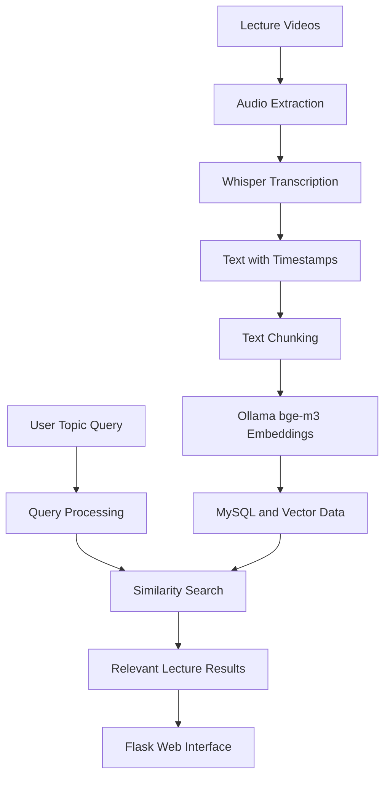

# 🎓 LectureLens

**Find Any Topic. Jump to the Exact Moment.**

LectureLens is a web application designed to help students find specific topics inside Python lecture videos without manually watching entire lectures. Search for a concept, discover relevant lecture content, and locate the timestamp where that topic is discussed.

The project combines speech transcription, text embeddings, similarity search, MySQL database storage, and a Flask web interface to make lecture revision faster and easier.

---

## 🌐 Project Status

**Currently under development**

- GitHub Repository: [LectureLens](https://github.com/Rishiraj-Singh-Thakur/LectureLens)
- Live Demo: To be added after deployment.

---

## 📌 Project Overview

Finding a particular topic in a long programming lecture can take considerable time. Students often need to search through multiple videos to find explanations of concepts such as loops, dictionaries, functions, or object-oriented programming.

LectureLens aims to solve this problem by connecting searchable lecture content with its corresponding timestamps.

The project brings together:

- Lecture audio processing
- Speech-to-text transcription using OpenAI Whisper
- Text chunking and embedding generation
- Semantic similarity search
- MySQL database integration
- A Flask-based web application
- A simple interface for finding relevant lecture content

---

## 🎯 Problem Statement

When revising a programming course, students may remember a topic but not the lecture or timestamp where it was explained.

Manually searching through long videos can be time-consuming.

LectureLens is designed to make this process easier by allowing users to search for a topic and find relevant lecture content with timestamps.

## 💡 Proposed Solution

LectureLens processes lecture content into searchable text and associates that content with lecture metadata and timestamps.

When a user searches for a topic, the application uses its search pipeline to retrieve relevant content and help the user identify where to continue watching.

**Example queries:**

- Where are loops explained?
- Which lecture covers dictionaries?
- Find the explanation of OOP.
- Where is list comprehension taught?
- Find the lecture about Python functions.

---

## ✨ Features

### 🔎 Topic Search
Search for programming concepts and retrieve relevant lecture content.

### ⏱️ Timestamp Discovery
Identify timestamps associated with matching lecture content.

### 🎙️ Audio Transcription
Use OpenAI Whisper to convert lecture audio into text.

### 🧠 Text Embeddings
Generate text embeddings using Ollama's `bge-m3` model.

### 🔍 Similarity Search
Use Scikit-learn-based similarity search to identify relevant content.

### 🗄️ MySQL Integration
Store and retrieve lecture-related information from a MySQL database.

### 🌐 Web Interface
Access the application's search and lecture-related functionality through a Flask web interface.

### 🎬 Lecture Processing
Support the lecture-processing workflow for preparing video and audio content for searching.

---

## 🏗️ System Architecture

The following diagram represents the intended end-to-end processing and search workflow.



*Note: This is a conceptual representation of the processing and search pipeline. The final diagram should be updated if the implementation changes.*

---

## ⚙️ How It Works

### 1. Lecture Input
Lecture videos are prepared for processing.

### 2. Audio Processing
Audio is extracted from videos when required, using the project's media-processing workflow and FFmpeg.

### 3. Speech Transcription
OpenAI Whisper converts spoken lecture content into text.

### 4. Text Chunking
Transcribed content is divided into smaller sections suitable for searching, while retaining the relevant lecture and timestamp information.

### 5. Embedding Generation
Ollama's `bge-m3` model generates vector representations of text for semantic comparison.

### 6. Data Storage
Lecture metadata and searchable content are stored in the project's database and vector-data workflow.

### 7. Topic Search
A user enters a programming topic through the web interface.

### 8. Similarity Search
The search pipeline identifies relevant lecture content based on similarity.

### 9. Results
The application presents relevant lecture information and associated timestamps so the user can locate the explanation more easily.

---

## 🛠️ Tech Stack

| Category | Technology |
|---|---|
| Programming Language | Python |
| Backend | Flask |
| Frontend | HTML, CSS, JavaScript |
| Database | MySQL |
| Speech Transcription | OpenAI Whisper |
| Embedding Model | Ollama — `bge-m3` |
| Similarity Search | Scikit-learn |
| Data Processing | Python |
| Media Processing | FFmpeg |
| Version Control | Git and GitHub |
| Development Environment | Anaconda, VS Code |

---

## 📂 Project Structure

```text
Lecture Timestamp Finder (Project -2)/
│
├── 01_data/                    # Local data and processing files
│   ├── 01_Videos/              # Source videos (local)
│   ├── 02_audios/              # Extracted audio (local)
│   └── processing/             # Intermediate files (local)
│
├── 02_vectors/
│   └── chunk_vectors.npy       # Local vector data, excluded from Git
│
├── 03_backend/
│   ├── lecture_links.py        # Lecture links and related functionality
│   ├── search_engine.py        # Search and retrieval logic
│   ├── sql_practice.py         # SQL-related code
│   └── uploading_on_database.py # Database upload functionality
│
├── 04_scripts/
│   └── ...                     # Processing and utility scripts
│
├── 05_templates/
│   └── templates/              # HTML templates
│
├── 06_static/
│   └── static/                 # CSS, JavaScript and static assets
│
├── app.py                      # Flask application entry point
├── requirements.txt            # Python dependencies
├── .gitignore                  # Excluded files and directories
├── .env                        # Local configuration (not committed)
└── README.md                   # Project documentation
```

*Folder descriptions should be checked against the actual files before this section is finalized.*

---

## 💻 Requirements

Before setting up LectureLens locally, ensure the following are available:

- Python and pip
- MySQL Server
- Ollama
- Ollama's `bge-m3` embedding model
- FFmpeg
- Git

Whisper and other Python dependencies are installed through `requirements.txt`.

---

## 🚀 Local Installation and Setup

### 1. Clone the Repository

```bash
git clone https://github.com/Rishiraj-Singh-Thakur/LectureLens.git
cd LectureLens
```

### 2. Install Python Dependencies

```bash
pip install -r requirements.txt
```

### 3. Configure Environment Variables

Create a `.env` file in the project root:

```env
FLASK_SECRET_KEY=your_secret_key
MYSQL_HOST=localhost
MYSQL_PORT=3306
MYSQL_USER=your_mysql_username
MYSQL_PASSWORD=your_mysql_password
MYSQL_DATABASE=lecture_timestamp_finder
```

Replace the example values with your own local configuration.

### 4. Prepare MySQL

Ensure that MySQL Server is running and the configured database exists. Any required tables should be created using the project's database setup workflow.

### 5. Prepare Ollama

Install Ollama and download the embedding model:

```bash
ollama pull bge-m3
```

Ensure Ollama is running before using functionality that depends on it.

### 6. Configure FFmpeg

Install FFmpeg and ensure it is accessible from your terminal if the lecture-processing scripts require it.

### 7. Run the Application

```bash
python app.py
```

Open the local URL printed in the terminal to access the application.

---

## 🔐 Environment Variables and Security

LectureLens uses environment variables for configuration.

| Variable | Purpose |
|---|---|
| `FLASK_SECRET_KEY` | Flask session and application secret |
| `MYSQL_HOST` | MySQL server hostname |
| `MYSQL_PORT` | MySQL server port |
| `MYSQL_USER` | MySQL username |
| `MYSQL_PASSWORD` | MySQL password |
| `MYSQL_DATABASE` | Database name |

**Security guidelines:**

- Never commit `.env` files or database passwords.
- Never hard-code API keys or other secrets in source files.
- Keep local videos, audio, and large intermediate data files out of Git when they are not required in the repository.
- Rotate any credential that has been exposed.

---

## 📸 Application Screenshots

Screenshots will be added after capturing the current application interface.

Suggested layout:

### 🏠 Home Page
``

### 🔎 Topic Search
``

### ⏱️ Search Results and Timestamps
``

*Create the `screenshots/` directory and add the corresponding image files before enabling these images in the published README.*

---

## 🧩 Challenges and Learnings

This project provides practical experience with:

- Processing long-form educational audio
- Transcribing spoken content into searchable text
- Working with text embeddings and semantic retrieval
- Preserving timestamp information during processing
- Connecting Python applications to MySQL
- Integrating search functionality into Flask
- Managing Python dependencies and local configuration
- Using Git and GitHub to version-control a project
- Preparing an application for deployment

---

## 🔮 Future Improvements

Potential improvements include:

- Deploy the web application and publish a live demo.
- Add direct links that open videos at the relevant timestamps.
- Improve ranking of search results.
- Add filters for lectures and topics.
- Expand support to additional courses and subjects.
- Improve processing performance for longer lecture collections.
- Improve error handling and search-result presentation.
- Add a more comprehensive set of application screenshots.

---

## 👨‍💻 Author

**Rishiraj Singh Thakur**

*Python | Data Science | Machine Learning | SQL*

- **GitHub Repository:** [LectureLens](https://github.com/Rishiraj-Singh-Thakur/LectureLens)

---

## ⭐ Project Highlights

- **Educational Search:** Find programming concepts inside lecture content.
- **Speech-to-Text:** Use Whisper to transcribe lecture audio.
- **Semantic Retrieval:** Use embeddings and similarity search to find relevant content.
- **Database Integration:** Manage searchable lecture data using MySQL.
- **Full-Stack Application:** Combine Python, Flask, HTML, CSS and JavaScript.
- **End-to-End Learning:** Build a practical application spanning media processing, NLP-related tooling, database management and web development.
